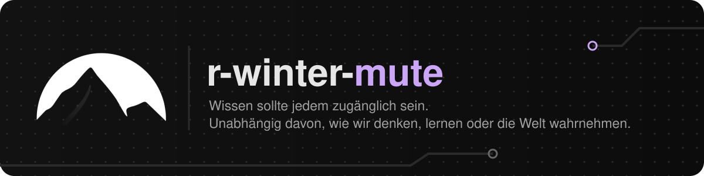

  

  <a href="README.md">English</a> · <strong>Deutsch</strong>

## Über mich

Als selbst neurodivergenter Mensch kenne ich die Herausforderungen, die ein Leben außerhalb der gesellschaftlich häufig vorausgesetzten Normen mit sich bringen kann. Die Schwierigkeiten, passende Informationen zu finden, verstanden zu werden, geeignete Lernmethoden zu entdecken und Zugang zu hilfreicher Unterstützung zu erhalten, sind nicht nur theoretische Themen, sondern Teil meines eigenen Lebensweges.

Aus genau diesen Erfahrungen ist die Motivation entstanden, etwas zu schaffen, das ich mir selbst an vielen Stellen gewünscht hätte.

Mit Unterstützung von künstlicher Intelligenz, wissenschaftlichen Erkenntnissen und frei zugänglichem Wissen entwickle ich digitale Plattformen und Werkzeuge, die Menschen dabei helfen sollen, sich selbst besser zu verstehen, Wissen zu erwerben und ihren eigenen Weg zu finden.

## Projekte

| Projekt | Worum es geht | |
| --- | --- | --- |
| **[0 to Hero](https://github.com/r-winter-mute-dev/zerotohero)** | Kostenloser, interaktiver Elektronikkurs für alle, die bei null anfangen. Kleine Schritte, Spickzettel, wenig Ablenkung. Erste Kampagne: eine smarte Türklingel. | [Zum Kurs](https://r-winter-mute-dev.github.io/zerotohero/) |
| **[ANXIETY.OS](https://github.com/r-winter-mute-dev/ANXIETY.OS)** | Kostenlose Akuthilfe im Browser bei starker Angst, auf Grundlage der kognitiven Verhaltenstherapie. Ein Schritt pro Bildschirm, alles per Antippen, offline nutzbar, nichts wird gespeichert. Entwurf, noch nicht fachlich geprüft. | [Zur App](https://r-winter-mute-dev.github.io/ANXIETY.OS/) |

## Meine Motivation

Ich bin überzeugt davon, dass niemand aufgrund seiner neurologischen Voraussetzungen, seiner Lebensumstände oder seiner finanziellen Möglichkeiten schlechtere Chancen auf Wissen, Bildung und persönliche Entwicklung haben sollte.

> Nicht jeder Mensch lernt gleich. 
> Nicht jeder Mensch verarbeitet Informationen gleich. 
> Und nicht jeder Mensch benötigt dieselbe Art von Unterstützung.

Genau das sollte kein Hindernis sein, sondern bei der Entwicklung von Lern- und Wissensangeboten berücksichtigt werden.

## Was ich erreichen möchte

- Wissenschaftlich fundiertes Wissen **verständlich und zugänglich** machen.
- Lernumgebungen schaffen, die **unterschiedliche kognitive Bedürfnisse** berücksichtigen.
- **KI sinnvoll einsetzen**, um individuelles und selbstbestimmtes Lernen zu ermöglichen.
- Selbsthilfeangebote entwickeln, die auf **nachvollziehbaren Erkenntnissen** statt auf unbelegten Versprechen beruhen.
- Menschen dabei unterstützen, **sich selbst und ihre individuellen Bedürfnisse** besser zu verstehen.
- Zugang zu Wissen **unabhängig von Herkunft, finanziellen Möglichkeiten oder neurologischen Voraussetzungen** ermöglichen.

## Grundgedanken

| | |
| --- | --- |
| **Wissen statt Vorurteile** | Informationen sollten auf wissenschaftlichen Erkenntnissen beruhen und verständlich vermittelt werden. |
| **Verständnis statt Anpassungsdruck** | Menschen sollten nicht erst lernen müssen, ihre individuellen Bedürfnisse zu verstecken, um Zugang zu Bildung zu erhalten. |
| **Technologie als Werkzeug** | KI soll Menschen unterstützen, nicht ihre Selbstständigkeit oder Entscheidungsfreiheit ersetzen. |
| **Erfahrungen als Antrieb** | Die eigene Lebensgeschichte ist der Ausgangspunkt dieser Projekte. Sie ist jedoch nicht der Maßstab für die Erfahrungen anderer. |

## Meine Vision

Ich erwarte nicht, die Welt allein verändern zu können.

Aber ich kann versuchen, Werkzeuge zu entwickeln, die jemand anderem den Weg erleichtern, den ich selbst teilweise nur unter großen Schwierigkeiten gefunden habe.

Wenn dadurch auch nur ein Mensch früher die Informationen, Unterstützung oder das Verständnis findet, das ihm bisher gefehlt hat, hat diese Arbeit bereits einen Sinn.

**Denn Wissen sollte kein Privileg sein.**

---

  <em>Aus persönlichen Erfahrungen entstanden. Mit Wissenschaft und Technologie weiterentwickelt. Für alle zugänglich gemacht.</em>

  Gewidmet meinen Helden <a href="https://www.wauland.de/">Wau Holland</a> und dem <a href="https://www.ccc.de/">Chaos Computer Club</a>, die einen großartigen Job machen und gemacht haben.

  <em>„Öffentliche Daten nützen, private Daten schützen.“</em> – Wau Holland

