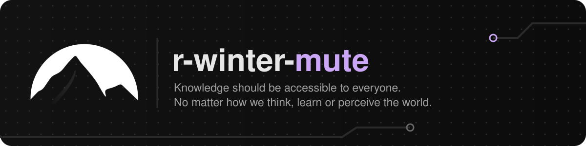

  

  <strong>English</strong> · <a href="README.de.md">Deutsch</a>

## About me

As a neurodivergent person myself, I know the challenges that can come with living outside the norms society so often takes for granted. Finding the right information, being understood, discovering learning methods that actually work and getting access to helpful support are not just theoretical topics to me. They are part of my own path through life.

These experiences are exactly what motivated me to build something I would have wished for myself in many places.

With the help of artificial intelligence, scientific findings and freely available knowledge, I develop digital platforms and tools that are meant to help people understand themselves better, acquire knowledge and find their own way.

## Projects

| Project | What it is about | |
| --- | --- | --- |
| **[0 to Hero](https://github.com/r-winter-mute-dev/zerotohero)** | A free, interactive electronics course for complete beginners. Small steps, cheat sheets, few distractions. First campaign: a smart doorbell. Currently in German. | [Open the course](https://r-winter-mute-dev.github.io/zerotohero/) |

## My motivation

I am convinced that nobody should have worse chances at knowledge, education and personal growth because of their neurological makeup, their life circumstances or their financial means.

> Not everyone learns the same way. 
> Not everyone processes information the same way. 
> And not everyone needs the same kind of support.

This should not be an obstacle. It should be taken into account whenever learning and knowledge resources are designed.

## What I want to achieve

- Make scientifically grounded knowledge **understandable and accessible**.
- Create learning environments that take **different cognitive needs** into account.
- **Use AI meaningfully** to enable individual, self-directed learning.
- Develop self-help resources based on **traceable evidence** instead of unproven promises.
- Help people better understand **themselves and their individual needs**.
- Make knowledge accessible **regardless of background, financial means or neurological makeup**.

## Core principles

| | |
| --- | --- |
| **Knowledge instead of prejudice** | Information should be based on scientific evidence and explained in a way people can understand. |
| **Understanding instead of pressure to conform** | People should not have to learn to hide their individual needs before they get access to education. |
| **Technology as a tool** | AI should support people, not replace their independence or their freedom to decide. |
| **Experience as a driving force** | My own life story is the starting point of these projects. It is not, however, the measure for anyone else's experience. |

## My vision

I don't expect to change the world on my own.

But I can try to build tools that make the path easier for someone else, a path I sometimes only found with great difficulty myself.

If even one person finds the information, support or understanding they have been missing a little sooner because of this, then this work has already been worthwhile.

**Because knowledge should not be a privilege.**

---

  <em>Born from personal experience. Developed further with science and technology. Made accessible to everyone.</em>

